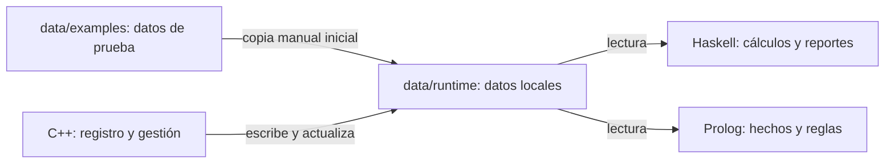

# Arquitectura inicial — Sprint 0

## Alcance y fuentes

Base mínima de un programa de consola y dos módulos independientes, comunicados mediante archivos. No se necesitan servicios, procesos coordinadores ni persistencia distinta de CSV.

Requisitos cotejados con los documentos entregados por el equipo:

- `2026-2-PP-Eval-3_Proyecto (enunciado) (1).pdf`: secciones 3 y 4 para campos mínimos y funcionalidades base.
- `Propuesta_G1.docx.md`: Anexo A, escenario, reparto y cuatro adicionales registrados.

Estos nombres identifican las fuentes; no son dependencias de ejecución ni rutas a archivos incluidos en el repositorio. La distribución oficial se conserva en el README y en los TODO. No se versionan copias de documentos con datos personales.

## Organización

El diagrama describe la integración futura. En este sprint los puntos de entrada no leen ni escriben CSV. Haskell y Prolog mostrarán resultados; las decisiones que cambien datos deberán aplicarse en C++.

Un archivo por integrante y lenguaje permite comenzar en paralelo. Las funciones y predicados reales se exportarán cuando se acuerden sus firmas. No se crean interfaces especulativas, funciones que devuelvan resultados inventados, ni tipos de negocio vacíos para aparentar avance.

La carga de módulos Haskell y Prolog está preparada. En C++ se compilan los cinco `.cpp`; `cpp/tipos.h` define las estructuras compartidas de los cuatro CSV base. `haskell/Carlos.hs` implementa los tipos de 4.2.2. El uso y la correspondencia de campos se documentan en `TIPOS_COMPARTIDOS.md`. Las demás funcionalidades siguen pendientes. No hace falta una jerarquía de clases.

## Puntos de coordinación

| Elemento | Coordinación necesaria |
| --- | --- |
| `cpp/main.cpp` | Carlos integra el menú 4.1.1 con las funciones de todos. |
| `haskell/Main.hs` | Diego integra la salida 4.2.7 con lectores, tipos y cálculos. |
| `prolog/main.pl` | Coordinar importaciones y exportaciones; Carlos prepara hechos en 4.3.1. |
| Tipos Haskell | Carlos define 4.2.2 y acuerda su uso con los otros tres integrantes. |
| Datos C++ | Carlos registra, Nicolás carga/guarda, Valentino cambia estados y Diego consulta. Todos necesitan estructuras compatibles. |
| Asignación y agua | Valentino gestiona 4.1.4 y Carlos stock/reservas; deben integrar ambas validaciones y guardados. |
| Contrato y ejemplos | Un cambio de columna afecta lectores de los tres lenguajes. Avisar y revisar juntos. |

## Adicionales: límites acordados en la propuesta

- Carlos: `stock_agua.csv`; agua libre = stock − reservas. Reservar al asignar, descontar stock y liberar reserva al entregar; permitir reposiciones. Solo C++.
- Nicolás: `horarios_recepcion.csv`; una ventana por destino y dentro del mismo día. C++ registra; Haskell calcula llegada, espera y fin de descarga y ordena rutas válidas por fin. No asigna automáticamente.
- Valentino: C++ consulta unidad y pedido; Haskell simula recargas cuando el pedido supera la capacidad. Usa rutas habilitadas de doble sentido y omite el retorno tras la última entrega. No agrega CSV, cambia estados ni reservas. La regla base de asignación sigue exigiendo capacidad suficiente.
- Diego: `dimensiones_cisternas.csv` y `restricciones_altura.csv`; C++ registra medidas positivas y Prolog evalúa compatibilidad con reglas y backtracking. La ausencia de restricción en una conexión significa que no hay límite de altura registrado.

## Decisiones que el equipo debe cerrar

1. Usar las estructuras de `cpp/tipos.h` y los tipos exportados por `haskell/Carlos.hs`; acordar las firmas de funciones C++ y los nombres/argumentos de los hechos Prolog. Mantener los identificadores CSV sin cambiar mayúsculas ni perder ceros.
2. Orden del trabajo y primer PR de tipos/lectores para que los demás puedan consumirlos. Los responsables siguen siendo los del Anexo A.
3. Mecanismo sencillo para guardar cambios coherentes entre pedidos, unidades y stock: qué ocurre si falla uno de los archivos y cómo recuperar. No permitir lecturas durante una actualización parcial; no hay transacciones implementadas.
4. Política de errores: archivos ausentes, cabeceras incorrectas, referencias inválidas y errores numéricos. Evitar saltar filas silenciosamente o interpretar un fallo como una lista vacía válida.
5. Cómo presentar consultas y resultados entre programas: ejecución manual inicial o invocación posterior desde el menú. No hace falta decidirlo con un orquestador en Sprint 0.
6. Política de litros fraccionarios, redondeo de costos y desempates de rutas/prioridades. El contrato inicial usa litros enteros y soles decimales; cualquier ampliación se revisará entre los tres lenguajes.
7. Comportamiento si faltan horarios o la dimensión de una unidad. La ausencia de límite de una vía sí está definida en la propuesta; la ausencia de altura de una cisterna no debe interpretarse como altura cero.
8. El contrato ya adopta `tipo` y `zona` de los CSV de prueba actuales; conservar la unidad en pedidos entregados para el historial. Antes de integrar stock, corregir coordinadamente la diferencia entre los 4000 litros reservados del ejemplo y los 12000 litros de pedidos asignados.

No se agregan todavía pruebas de algoritmos inexistentes. Al implementar cada funcionalidad, acompañarla de ejemplos de entrada, resultado esperado y comprobaciones de sus errores relevantes.
